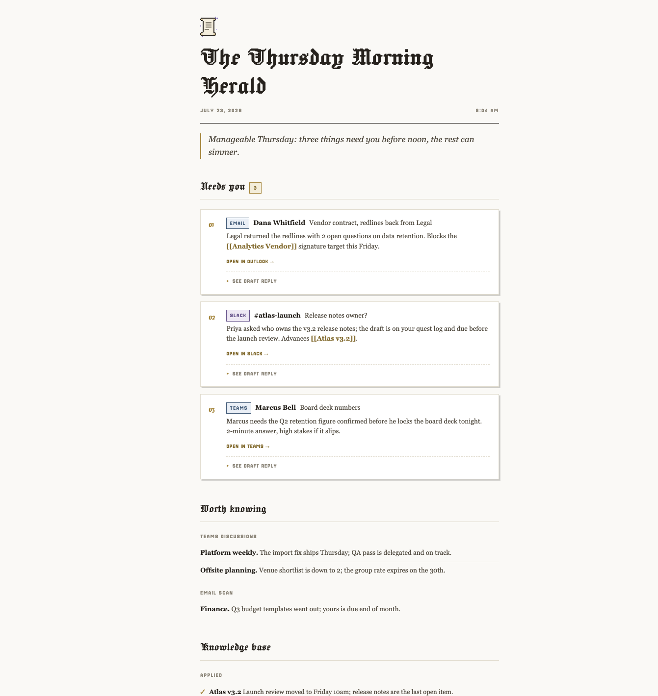
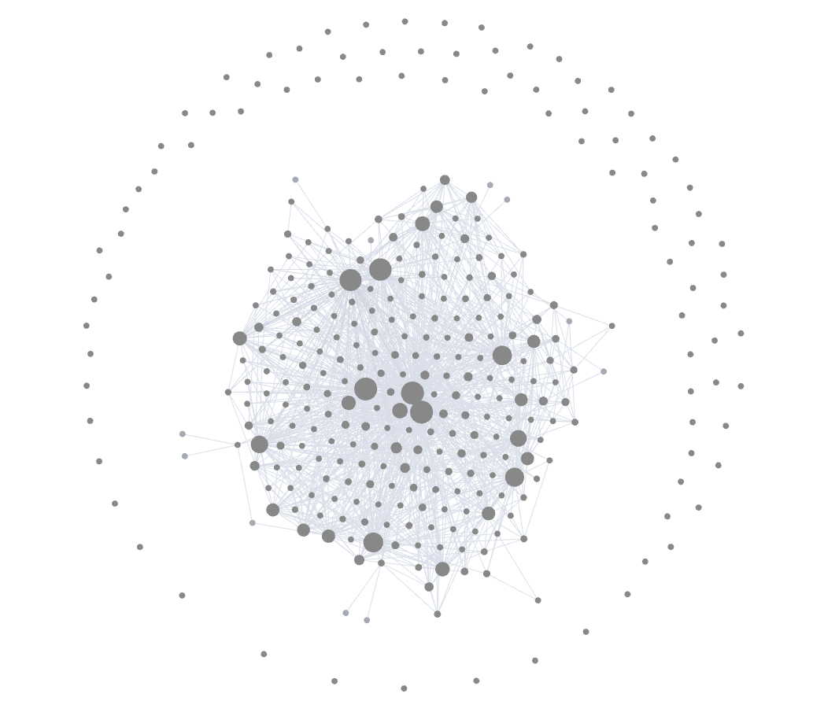
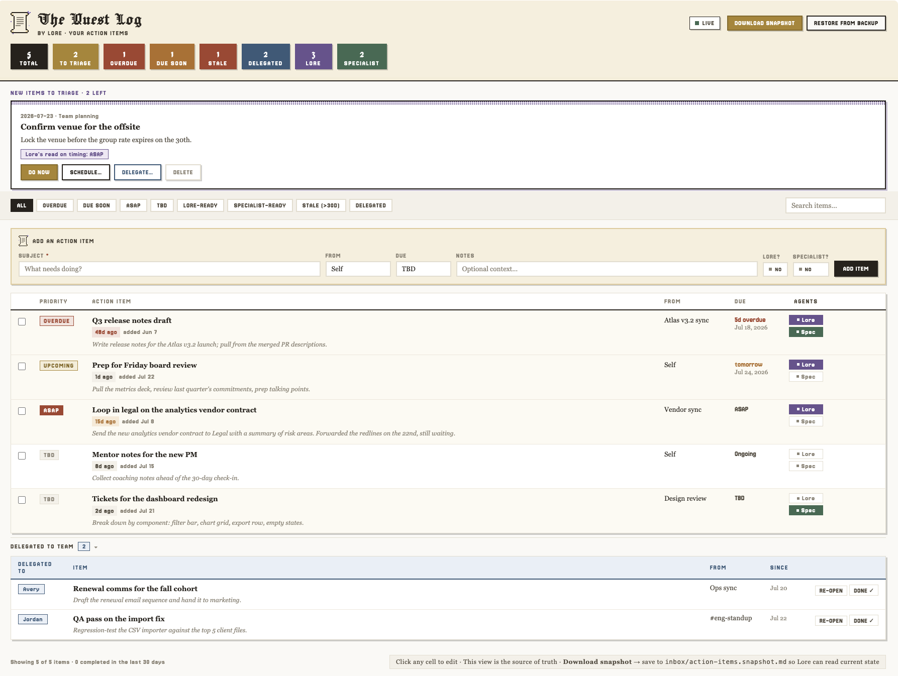

<p align="center">
  
</p>

<h1 align="center">Lore</h1>

<p align="center"><em>May your scroll stay short.</em></p>

---

**Your second brain, your magic scroll.** Lore is a personal AI executive assistant that lives in a folder of markdown files: a mage-scribe that turns Claude (or any agent that reads a CLAUDE.md and a folder of workflow files) into a long-running, context-aware partner for managing your role, your team, your stakeholders, and your work.

**Lore is not a standalone application.** It's a Claude Cowork project, a set of configuration and instruction files (`CLAUDE.md`, workflow markdown, templates) that direct Claude, a tool your org has already approved, to behave as a persistent assistant. There's no separate executable, no server, and no account beyond the Claude access you already have. Everything runs inside Claude Cowork or Claude Code, and every file in the folder is plain markdown you can read and edit yourself.

Lore stays out of your way until you need it, remembers what matters across sessions, and adapts to how you like to work. Like any good scroll, it grows more valuable with every entry.

Lore's signet is the scroll: 📜. You'll see it on the agent's signed outputs (briefs, talk tracks, weekly reviews, signed-off meeting notes). It marks work that came from Lore.

New here and not technical? Start with the designed setup guide at **`docs/lore-setup-guide.pdf`**: 8 pages, non-technical, covers everything from install to daily rituals. Already set up, or just updated? **The Keeper's Grimoire** at **`docs/lore-grimoire.pdf`** is the companion for daily use: what's new in each release, your migrations, the Quest Log, connecting tools, where your knowledge lives, everyday prompts, and fixes for common snags. This README is the full reference. Lore's visual identity (colors, pixel fonts, dither textures, the sprite signet, and UI components) lives in **`design-system/`** at the repo root; every designed surface Lore ships is built from it.

---

## Getting started

### 1. Get the Lore folder

Lore lives at `~/src/lore` (Mac/Linux) or `$HOME\src\lore` (Windows). Companion specialist agents reference this path; using a different location means you'll have to edit their instructions to match. Two ways to get it there:

**Option A, the package (no git needed).** From this repository's **Releases** page, download the latest `lore-<version>.zip` plus the installer for your platform (`Install-Lore-Mac.zip` or `Install-Lore-Windows.bat`) and double-click the installer; it finds the downloaded package and sets up the folder at the path above. (Mac: right-click → Open the first time.) Or skip the installer and unzip the package there yourself. Updates arrive the same way, applied for you by Lore itself; see **Staying up to date** below.

**Option B, git (developers and contributors).** Use this repository's clone URL (the **Code** button above); a fork works the same way.

**Mac / Linux:**
```bash
mkdir -p ~/src
git clone <repo-url> ~/src/lore
cd ~/src/lore
git submodule update --init
```

**Windows (PowerShell):**
```powershell
New-Item -ItemType Directory -Force "$HOME\src"
git clone <repo-url> "$HOME\src\lore"
cd "$HOME\src\lore"
git submodule update --init
```

The submodule step pulls `external/skills/` ([mattpocock/skills](https://github.com/mattpocock/skills)), an upstream skills library that some workflows wrap. To pull upstream updates later, run `./scripts/update-external-skills.sh`. (Package installs skip the submodule; the workflows that wrap it degrade gracefully.)

### 2. Open the folder in your AI agent

Lore is designed to work with agents that read a top-level `CLAUDE.md` and treat the folder as a persistent workspace. The reference setup is **Cowork** (the desktop app that ships Claude as a workspace agent) or **Claude Code** running in this directory.

Other configurations work too, Lore is just markdown files. Any agent that can read and edit files in the folder can run it.

### 3. Run onboarding

The first time you talk to your agent in this folder, it will detect that `context.md` is missing and run the onboarding interview automatically. The interview takes 10 to 15 minutes and walks you through:

1. Your role, title, company, who you report to, and your timezone.
2. Your primary duties and current focus.
3. Your direct reports (if any), one by one.
4. Your key stakeholders.
5. Your active initiatives and current challenges.
6. The tools you use, one job at a time (email, team chat, calendar, meeting notes, work tracker, docs). Lore first checks which connectors your Claude setup can already reach, so it can say "I can already see Slack and Linear" and only ask about the rest.
7. Where your knowledge base should live: this folder (the default), Notion, or Obsidian.
8. Your working style preferences and how you'd like Lore to communicate with you (concise, warm, analytical, coach-style, executive briefing, or your own custom style).
9. Your daily brief schedule (morning, afternoon, or both), if an email or chat tool is connected; onboarding then runs your first sweep on the spot and delivers your first Herald so you see it working before you're done.

You can pause anytime, skip phases that don't apply, and come back later by saying "run onboarding."

By the end, Lore will have generated:
- `context.md`, your master profile.
- `team/[firstname].md`, one file per direct report.
- `stakeholders/[firstname-lastname].md`, one file per stakeholder.
- The Quest Log, a hosted claude.ai artifact (empty, ready to use, private to you). This is the canonical action items tracker; its URL is saved in `context.md` and no local file is created for it.
- A Connectors table in `context.md` recording which tool you use for each job and whether it's connected.
- If you chose Notion, a private Lore page in your Notion space with People, Projects, Meetings, Decisions and Notes databases.

### 4. Start using it

Once onboarding is done, try any of these:

| Task | Prompt |
|------|--------|
| See open tasks | "Show my action items" |
| Process a meeting | "Process this transcript:" then paste, or drop a file in `meetings/transcripts/` |
| Process raw notes | "I have some notes to process" then paste or upload, works for typed notes, OneNote exports, and photos of handwritten notes |
| Prep for a 1:1 | "Help me prepare for my 1:1 with [name]" |
| Start the day | "Morning sync" |
| Triage your channels | "Triage everything" or "What needs me today?" |
| Connect a new tool | "I connected Linear" or "Check my connectors" |
| End the week | "Run my weekly review" |
| See your quarter in charts | "Unroll my scroll" |
| Make a decision | "Help me think through a decision about [topic]" |
| Get unblocked | "I need help with [stakeholder situation]" |
| Finish an update | "Run migrations" |

You don't need to memorize prompts. Just describe what you want, and Lore will route to the right workflow. The Keeper's Grimoire (`docs/lore-grimoire.pdf`) has a fuller list by time of day.

### Optional integrations

Lore doesn't assume a tool stack. During onboarding it checks which connectors your Claude setup can already reach, asks what you use for each job (email, team chat, calendar, meeting notes, work tracker, docs, any shared inbox), wires up the ones that are connected, and tells you where to connect the rest. Say **"check my connectors"** anytime to rescan. The paragraphs below describe the integrations Lore has adapters for today. See `workflows/connectors.md`.

If you carry a voice recorder with an MCP connector of your own choosing, Lore can pull transcripts directly instead of dropping files manually. Nothing here requires a specific device or vendor; connect whichever MCP-enabled recorder you already use. The reference implementation is [Plaud](https://www.plaud.ai/) ([setup](https://docs.plaud.ai/documentation/plaud_app/mcp)): once connected, say "Sync Plaud from the last week" (or any time range) and Lore will fetch unprocessed recordings and walk you through them.

**Triage** sweeps the email and team-chat tools you named during onboarding. Adapters exist today for **Outlook** and **Teams** (via the Microsoft 365 connector) and **Slack**; a tool you use without an adapter yet (Gmail, Google Chat, a shared inbox such as Front) is listed in the brief as not swept. Say "triage everything" and Lore sweeps your inbox, your Slack DMs / mentions / project channels, and your Teams chats, then drafts responses grounded in your knowledge base and writing voice. It skips threads you already answered and re-checks each thread right before drafting. It is draft-and-hold: nothing sends without you. Email replies become native Outlook drafts and Slack replies native drafts in your "Drafts & Sent"; Teams replies are staged as paste-ready files in `outbox/drafts/` because that connector can't write. Multi-person Teams group chats are summarized rather than answered, and Lore asks before adding anything it learns to your knowledge base. Each run delivers a designed HTML daily brief to `outbox/briefs/` (prioritized "needs you" items with deep links back to the source message and expandable draft replies), with a plain-markdown fallback in `outbox/triage/`. Onboarding sets this up on a schedule (morning, afternoon, or both, weekdays); say "change my brief schedule" to adjust anytime. See `workflows/triage.md`.

And when a quarter (or a year) closes, say **"unroll my scroll"** for **Lore, Unrolled**: a Wrapped-style recap page with dithered charts of everything Lore counted for you, quests completed, your heaviest meeting day, who sends you the most work, how the knowledge base grew, and a conservative, math-shown estimate of the hours Lore gave back. Every number is a real count from your own records; stats without data simply don't appear. See `workflows/unrolled.md`.

Two companion routines keep the knowledge base healthy: the **KB sweeper** (`workflows/kb-sweeper.md`, "run the sweeper") reads your named Slack channels, Teams messages, and email a couple of times a day and proposes or appends vault updates, review-gated and changelogged, never silent; **vault lint** (`workflows/vault-lint.md`, "lint the vault") is the weekly health check: broken wikilinks, schema drift, stale notes, archive proposals.

Filesystem mode (the default above) works completely on its own. If you'd rather, Lore can store entity data (people, meetings, decisions, projects) in **Notion** (private databases with two-way links; see **Notion as your knowledge base** below) or in an **[Obsidian](https://obsidian.md/)** vault (wikilinks and backlinks; see **Obsidian integration**). This is entirely your call, not something Lore needs. If your work tracker is connected (Linear, Jira, Asana), triage drafts and recaps pull in the tickets a thread references.

---

## Staying up to date

Lore updates as a **self-applying package**; users never need git. Releases are GitHub Releases on the repository named in `update-channel.json` (a fork points it at its own repo), each with a versioned zip attached. Once a day, Lore quietly checks for a newer release at session start; when a new release exists it says so, and the user replies **"update"** to apply it.

Your personal context can't be touched by an update, by construction: every release zip carries a manifest listing exactly the files it may write (the committed agent logic: `CLAUDE.md`, `workflows/`, `templates/`, `playbooks/`, `scripts/`, `docs/`, the design system). Personal files are gitignored at the source, so they can never appear in a manifest, and the applier (`scripts/apply-update.py`) hash-verifies the whole package and refuses to write anything outside the manifest. A corrupt or tampered package aborts with zero changes. Same behavior on macOS and Windows.

Developers with git access can track the repo directly instead: `./scripts/update-lore.sh` (Mac/Linux), `./scripts/update-lore.ps1` (Windows), or plain `git pull --ff-only`. The two paths never conflict.

**Cutting a release (maintainers):** `./scripts/make-release.sh <version> "<notes>"` from a clean checkout. It tags, pushes and publishes the GitHub Release with the package attached (or tells you what to attach by hand if the `gh` CLI isn't set up). That's the whole pipeline. Full mechanics: `workflows/update.md`.


### Updating an existing install

When a release changes how your own data is organized (v1.1 moves the Quest Log onto its own database, adds a timezone and a connectors table, and offers Notion), Lore runs those steps as **migrations** right after the update, asking before anything you'd notice. If you put one off, it's offered again next session. Say **"run migrations"** anytime. The Keeper's Grimoire explains each one in plain language; mechanics: `workflows/migrations.md`.

---

## The Herald, your daily brief

Every triage run delivers **The Herald**: a designed HTML brief, a single self-contained file in `outbox/briefs/` that opens in any browser:



What makes it more than a pretty inbox summary:

- **It knows your work.** Every item is cross-referenced against your vault before it's ranked, so the "why it matters" line says what the message actually blocks or advances ("blocks Q3 Billing Migration"), not just who sent it.
- **Drafts are inline.** Items that need a reply carry the ready-to-send draft in an expandable block, with a grounding note naming the vault notes and messages it drew from. Review, click through, send.
- **Deep links, never fabricated.** Each item links straight to the source message in Outlook, Slack, or Teams. If a link can't be resolved, the item simply shows without one; Lore never invents an ID.
- **The knowledge base section shows its work.** What triage appended to your vault, and what it's proposing but won't write without you.
- **Verified before you see it.** An independent check confirms every claim traces to a source, every link is well-formed, and the tone passes `VOICE.md`.

The plain-markdown briefing still lands in `outbox/triage/` as a grep-able fallback. Template: `templates/brief.template.html`; it contains nothing user-specific, so you can restyle it without touching behavior.

---

## Notion as your knowledge base

If your team already lives in Notion, Lore can keep its knowledge base there instead of in this folder: say **"set up Notion"** (or pick Notion during onboarding). Lore creates a private **Lore** page in your Notion space with five databases (People, Projects, Meetings, Decisions, Notes) plus Context and Commitments pages. Everything Obsidian gives you has a Notion equivalent:

- **Frontmatter** becomes database properties (relationship, status, team, dates, tags).
- **Wikilinks and backlinks** become two-way relations: set a project's lead and the person's page lists the projects they lead; add attendees to a meeting and each person shows that meeting. Body references are page mentions, which Notion backlinks too.
- **Dataview queries** become database queries and views; a person's page shows their active projects and meetings without anything to maintain.
- **Archiving** is a checkbox, never a deletion.

Workflows, templates and scripts stay in this folder; action items stay in The Quest Log. The pages are private to you, though on some Notion plans workspace admins can reach private content. Already using this folder or Obsidian? Say **"migrate to Notion"** for a previewed move. Details: `workflows/notion-kb.md`.

## Obsidian integration

This is entirely optional. Lore's default mode (Filesystem mode, described everywhere else in this README) needs no third-party app at all; nothing about Lore requires Obsidian. If you already use Obsidian for your own notes and want Lore's data to live alongside them as linked notes, this section describes how to wire that up, on your own initiative, using your own existing installation.

Lore detects at session start whether a vault path is recorded in `context.md` (under "Notes for Lore" → "Vault Configuration"). If it is, Lore operates in **Obsidian mode**: the vault becomes the canonical store for entity data, and the agent uses wikilinks, backlinks, and frontmatter instead of the repo's data folders. If not, Lore operates in **Filesystem mode**, which is the original behavior described in the rest of this README, unchanged.

Vault access is direct: Lore reads and writes the vault's markdown files with its native file tools, the same way it reads and writes repo files in filesystem mode. No intermediary server, no index to maintain, and the Obsidian app doesn't need to be open. Obsidian picks up changes automatically. One optional plugin adds live Dataview query execution for interactive sessions (see Setup, step 3).

As your vault fills with people, meetings, decisions, and projects, Obsidian's graph view turns it into an explorable knowledge graph. Each node is an entity and each edge is a wikilink, so you can see at a glance how teammates, initiatives, and decisions connect:



*An example of an Obsidian linked knowledge graph*

### What this gives you

- **Each fact lives in exactly one place.** A teammate's role lives on their note in `Lore/People/`. Meeting notes wikilink to the person rather than restating role. Obsidian's backlinks pane on the person's note shows every meeting, decision, and observation involving them, without any duplication.
- **Native graph view.** People, projects, decisions, and meetings become nodes you can explore visually.
- **Surgical updates.** Lore edits notes in place (a new observation, a table row, one frontmatter key) instead of rewriting whole files, and validates frontmatter after every edit so your Dataview views never silently break.
- **No dependency on Obsidian being open.** Vault files are read and written directly, so scheduled jobs work with the app closed.
- **Live Dataview answers when Obsidian is open.** With the Semantic Notes Vault MCP plugin connected, Lore can execute the same Dataview queries you see rendered (like a person's Active Projects table) and reason from the actual results.

### Where Lore stores things in the vault

Lore operates from a dedicated `Lore/` subfolder inside your vault so it doesn't collide with your existing notes (the subfolder name is configurable in `context.md` under "Notes for Lore" → "Vault Configuration", which is useful if you maintain multiple Lore instances per org, e.g., `Lore - Acme/`, `Lore - Personal/`):

```
<your-vault>/
└── Lore/
    ├── People/         One note per person (direct reports, peers, stakeholders)
    ├── Meetings/       One note per meeting; wikilinks to People and Projects
    ├── Transcripts/    Transcripts you drop in yourself (Lore links recordings, never copies them)
    ├── Decisions/      One note per decision; wikilinks to People and Projects
    ├── Projects/       One note per project or initiative
    ├── Inbox/          Notes pending processing; tagged #inbox/unprocessed
    ├── Daily/          Daily notes, named by date (YYYY-MM-DD.md)
    └── Weekly/         Weekly notes, named by date (YYYY-MM-DD.md)
```

If you want a different subfolder name, record it in `context.md` under "Notes for Lore" and Lore will use that instead.

### What stays in the repo

The `lore/` repo still holds the agent logic (`CLAUDE.md`, `workflows/`, `templates/`, `playbooks/`), and the Quest Log template and helper script. Personal entity data (people, meetings, decisions, observations) moves into the vault. Operational tracking files (`.processed`, `.plaud-processed`, `.email-processed`) also stay in the repo because Obsidian ignores dotfiles.

The Quest Log is unchanged in Obsidian mode; its database remains the sole source of truth for action items.

### Setup

**Step 1: Install the Dataview community plugin in Obsidian**

Lore's People notes include a live "Active Projects" table that shows every project a person leads or is a stakeholder on, pulled automatically from the `Projects/` folder via Dataview. This means you update a project note once and every connected person note reflects it instantly, no manual list maintenance needed. Dataview also enables roster-style views across your vault (e.g., all active direct reports, all projects a person touches).

To install: open Obsidian, go to **Settings → Community plugins → Browse**, search for **Dataview**, and click Install then Enable. No configuration needed; the queries in People notes work out of the box once the plugin is active.

**Step 2: Record the vault path in context.md**

Under "Notes for Lore" → "Vault Configuration", add:
- The vault's full filesystem path. On macOS with iCloud sync, this is typically `~/Library/Mobile Documents/iCloud~md~obsidian/Documents/<VaultName>`
- The active subfolder convention (e.g., `Lore/`, or no prefix if Lore's content is at the vault root)

This is all Lore needs for vault reads and writes. On first launch after this step, Lore will announce "Obsidian mode active" and begin using the vault. Say "set up Obsidian" and Lore also seeds the working structure: the entity folders, a wikilinked `Context.md` at the vault root, and `Index.md`, the master catalog it reads first for orientation and keeps updated as notes are created or archived.

**Step 3 (optional, recommended): Install Semantic Notes Vault MCP for live Dataview queries**

Everything above works with plain file access, but Lore can't *execute* a Dataview query that way; it can only read the query text (Dataview runs inside the Obsidian app). The [Semantic Notes Vault MCP](https://community.obsidian.md/plugins/semantic-vault-mcp) plugin ([aaronsb/obsidian-mcp-plugin](https://github.com/aaronsb/obsidian-mcp-plugin)) closes that gap: while Obsidian is open, Lore can run your Dataview queries and get the same results you see rendered, traverse the link graph, and query Bases.

1. In Obsidian: **Settings → Community plugins → Browse**, search for **Semantic Notes Vault MCP**, Install and Enable.
2. In the plugin's settings tab, copy the API key.
3. Connect Claude Code / Cowork:

```bash
claude mcp add --transport http obsidian-vault http://localhost:3001/mcp --header "Authorization: Bearer YOUR_API_KEY"
```

Once connected, Lore prefers this plugin for queries whenever Obsidian is open, including scheduled jobs. When Obsidian is closed, Lore falls back to reading frontmatter directly, so everything still works; the answers just don't come from a live query run.

### Migration of existing filesystem data

If you have existing files in `team/`, `stakeholders/`, `decisions/log.md`, or `meetings/notes/` from filesystem mode, they stay where they are. They aren't auto-migrated. New data lands in the vault under `Lore/`. If you want a one-shot migration of existing data into the vault, ask Lore: *"Migrate my existing Lore data into the vault."* Lore will preview the changes before writing.

### Workflow coverage

Most workflows branch on storage mode and read from and write to the vault when one is configured. `process-transcript` and `plaud-sync` are fully migrated. If a workflow hasn't been given an Obsidian branch yet, Lore falls back to filesystem mode for that workflow and tells you.

### Troubleshooting

**Lore says "Filesystem mode" but you expect Obsidian mode**

Check that `context.md` has a "Vault Configuration" subsection under "Notes for Lore" with the vault's full filesystem path, and that the path exists (`ls "<path>"`). That path is the only thing mode detection looks at.

**Dataview queries aren't returning results to Lore**

The Semantic Notes Vault MCP only works while the Obsidian app is running. Open Obsidian and confirm the plugin is enabled, then check the MCP connection (`claude mcp list`). If the API key changed, re-add the server with the new key. When the plugin is unreachable, Lore falls back to reading frontmatter directly, so answers still work; they just don't come from a live DQL run.

**A note stopped appearing in a Dataview view**

Almost always malformed YAML frontmatter (an unquoted wikilink value or a stray tab). Open the note's properties in Obsidian; if Obsidian shows a parse warning, fix the YAML and the note reappears. Lore validates frontmatter after its own edits to avoid causing this.

---

## What's in the box

```
lore/
├── CLAUDE.md           ← Agent orientation and session-start checks. Read first, every session.
├── VOICE.md            ← Style contract. Every outward-facing artifact is checked against it.
├── README.md           ← You are here.
├── docs/               ← The designed guides: lore-setup-guide.pdf (first-time setup) and
│                         lore-grimoire.pdf (The Keeper's Grimoire: daily use, what's new), with sources.
├── design-system/ ← Lore's visual identity: tokens, components, dither assets, the sprite signet.
│
├── context.md          ← Your master profile (generated by onboarding; gitignored).
├── STATE.md            ← Session memory: verified facts, open failures, resume pointer (gitignored).
│
├── evals/              ← Voice eval harness. Your examples accumulate in evals/examples/ (gitignored)
│                         whenever you correct Lore's style; verifiers read them as calibration.
├── templates/          ← Canonical file templates Lore uses for new files.
├── workflows/          ← Workflow definitions (onboarding, action items, transcripts, etc.).
│   ├── _conventions.md ← Shared conventions: storage-mode branching, frontmatter schemas, tag taxonomy.
│   ├── connectors.md   ← Which tool you use for each job, and how Lore wires it up.
│   ├── notion-kb.md    ← Notion as the knowledge base: structure, schemas, operations.
│   └── migrations.md   ← Setup steps an update runs on an existing install.
├── playbooks/          ← Frameworks (stakeholder management, difficult conversations, feedback, etc.).
├── scripts/            ← Helper scripts: Quest Log operations (quest-log-ops.js), guide builder,
│                         Claude Code session digest, document PDF renderer, release tooling.
├── external/skills/    ← Git submodule pinning mattpocock/skills; wrapped by grill-me and handoff.
│
├── inbox/              ← Drop zone for documents to process; operational state (processed lists,
│                         migration record, Claude Code session digest).
├── outbox/             ← Generated outputs (reports, exports, prep docs, staged drafts).
│
├── team/               ← Profiles of your direct reports.
├── stakeholders/       ← Profiles of people you work with regularly.
│
├── meetings/
│   ├── notes/          ← Structured meeting summaries.
│   ├── transcripts/    ← Transcripts you drop in for processing. Synced recordings stay in their app; Lore links them.
│   └── templates/      ← Pre-meeting prep templates (1:1, decision meeting, etc.).
│
├── decisions/log.md    ← Decision log.
├── weekly-reviews/     ← Weekly review entries.
└── strategy/           ← Your strategy docs (vision, roadmap, etc.).
```

Personal files (everything in `inbox/`, `outbox/`, `team/`, `stakeholders/`, `meetings/notes/`, `meetings/transcripts/`, `weekly-reviews/`, `decisions/log.md`, `strategy/*.md`, and `context.md`) are gitignored. The repo only commits agent logic, templates, and the skills submodule pointer.

---

## Action items

Lore's most-used surface is its action items tracker, titled **"The Quest Log"** in the app. Every piece of work is a quest: new ones wait at the top for you to take them up, schedule them, hand them to a companion, or strike them from the record. It's the front door for *"what should I work on,"* the backbone of meeting follow-through, and the routing layer for delegating work to Lore itself or to a sibling specialist agent.



The artifact is styled with the **Lore design system** (`design-system/` at the repo root): a pixel-fantasy look on a parchment-and-ink base, ordered-dither textures, hard pixel shadows, square corners, a pixel blackletter display face, and the sprite scroll signet. Think "a scribe's desk rendered by a SNES." The same system styles the daily brief and the setup guide, so everything Lore ships is recognizably Lore.

The tracker is a **hosted claude.ai artifact** (pictured above) that keeps its items in its own database. You work in it directly, on claude.ai or inside Cowork, and Lore reads and writes the same records through the ArtifactData tool, so there is nothing to export, import, or sync. Changes Lore makes show up live while the page is open. The tracker is private to you (and anyone you make an editor) until you share it.

### What the tracker gives you

- **A triage pile at the top.** Items Lore extracts from transcripts arrive as proposals, one card at a time, each resolved with a single click: **Do now** (active, due ASAP), **Already done** (straight to Completed), **Schedule** (pick a due date), **Delegate** (straight to a teammate, or anyone you type), or **Delete** (never becomes an item). Nothing joins your list without you.
- **Add form at the top** for fast capture: subject, from, due, notes, and both delegation toggles, so new items get classified the moment they're created.
- **Priority-sorted rows** with badges for Overdue, Due Soon, ASAP, and TBD. Due dates are ASAP, TBD, a real date, or your own custom text.
- **Two delegation flags per row**, each independently toggleable:
  - **Lore** (arcane purple chip) for items Lore can do from inside the workspace.
  - **Specialist** (green chip) for items a sibling specialist agent (e.g., Sigil) can pick up autonomously off-session.
- **Age tracking.** Each row shows when it was added (e.g. *"92d ago · added Jan 29"*). A **Stale (>30d)** filter pill surfaces items aging in your backlog as candidates for archiving or follow-up.
- **Inline editing.** Click any cell to rename, change due dates via a popover, edit notes, toggle flags, or archive a row. Checking an item off strikes it through for five seconds before it completes, so a mis-click is undone by unchecking.
- **Search and stats** across the top: live counts for Total, To Triage, Overdue, Due Soon, Stale, Delegated, Lore, and Specialist.
- **Download snapshot** saves a markdown backup of every item; **Restore from backup** replaces every item from one, after a confirmation. Lore doesn't need either to see your list.

### How Lore and the tracker share the list

Every item is one document in the tracker's database, keyed by its subject and source. When you ask Lore to change action items (process a transcript, add an item, mark something complete), it reads the current documents, works out the change as operations (add, propose, complete, delegate, reopen, archive, dismiss, update), and writes only what changed. Each write is pinned to the version Lore read, so if you edited the same item in the page a moment earlier, Lore's write fails and it re-reads instead of overwriting you. Deleting an item leaves a quiet tombstone, so Lore never re-proposes something you threw away. Full mechanics: `workflows/action-items.md`.

### The two delegation flags in practice

Each Active row has two booleans that say "who could do this":

- **Lore = `Y`**, Lore can do or substantially advance this item from inside the workspace, in chat. Drafting docs, summarizing threads, generating prep briefs, querying connectors, building small artifacts.
- **Specialist = `Y`**, A sibling specialist agent can pick this up autonomously, off-session. Writing Jira tickets, drafting PRDs, scoping engineering work, generating release notes, pulling structured data from production systems.

The flags are independent. Both can be `Y` (either could do it), or both blank (you do it yourself), or one of each. When Lore adds an item, it sets these flags reflectively: "Could I do this? Could the specialist?" When you flag an item `Specialist: Y` and run your specialist, it queries the tracker for those rows, does the work, and writes a `complete` for each one; the change shows up in the open tracker right away.

See `workflows/action-items.md` for the full delegation contract, and the **Companion specialist agents** section below for how to wire one up.

---

## How this system works

1. **`context.md`**, Lore reads this to understand your role, company, team, priorities, and preferred communication style. Update it regularly.

2. **Team and stakeholder profiles**, Living documents that grow over time. Lore updates them automatically when processing meeting transcripts. You can also edit them directly.

3. **Decision log**, Captures key decisions with context, options considered, and rationale. Helps you revisit past choices and see patterns.

4. **Weekly reviews**, Structured reflection to maintain visibility and catch issues early.

5. **Workflows**, Each common task has a workflow file in `workflows/`. Lore reads the relevant one and follows its instructions when you ask.

---

## Recommended rituals

| Cadence | Ritual |
|---------|--------|
| Daily | Quick scan of The Quest Log; clear the triage pile, flag blockers or decisions needed. |
| Weekly (Monday) | Run weekly planning session. |
| Weekly (Friday) | Run weekly review; prep for any roundtable / leadership meeting. |
| Before 1:1s | Prep with Lore using the team member's profile. |
| After meetings | Drop the transcript in `meetings/transcripts/`; let Lore extract action items, decisions, and observations. |
| After taking notes | Say "I have some notes to process" and paste or upload your notes, Lore will ask a few quick questions and file everything in the right place. |
| Monthly | Update `context.md` priorities, review team development goals, update strategy docs. |
| Quarterly | Full strategy review, team performance conversations, OKR/goal setting. |

---

## Tips for working with Lore

1. **Be specific.** "[Direct report] is struggling with stakeholder X" beats "team issue."
2. **Share context.** The more Lore knows, the better the advice. Drop relevant docs in `inbox/documents/` and ask Lore to ingest them.
3. **Challenge back.** Ask "what am I missing?" or "play devil's advocate" when you want pushback.
4. **Keep `context.md` current.** Priorities, stakeholders, and active initiatives shift. A fresh `context.md` makes everything downstream sharper.
5. **Edit anything.** Lore writes plain markdown. If a generated file is wrong, fix it directly. Lore will pick up your edits next time.

---

## Privacy and data

Lore's files live on your machine. Two things live in your Claude and Notion accounts instead, by your choice: **The Quest Log** is a hosted claude.ai artifact, private to you until you share it, and if you choose **Notion** as the knowledge base, your people, project and meeting pages live in your private Notion space (on some Notion plans, workspace admins can reach private content). Connectors read only the tools, channels and projects you name. The `.gitignore` excludes all your personal data, so even if you push the repo to GitHub, only the agent logic and templates ship.

---

## Customizing Lore

You can edit:
- `CLAUDE.md` to change Lore's core behavior.
- `VOICE.md` to change the style every outward-facing artifact is held to.
- `workflows/*.md` to change how specific tasks work, or `workflows/_conventions.md` to change shared conventions (storage-mode branching, frontmatter schemas, tag taxonomy).
- `templates/*.md` to change the format of generated files.
- `playbooks/*.md` to change the frameworks Lore reaches for.
- `context.md` to change anything about you or how Lore should talk to you.

If you want a different tone or a different workflow, just edit the file. Lore reads the files fresh each session.

---

## Companion specialist agents

Lore is designed to work with sibling specialist agents that handle role-specific execution. The pattern is: Lore is the generalist context layer, specialists are the executors that read from Lore and act.

The action items artifact doubles as a delegation bus. Each Active row carries two independent boolean flags that say who could plausibly do the work:

- **Lore (`Y`)**, Lore can do the item from inside this workspace, in chat. Examples: drafting documents, summarizing threads, generating prep briefs, querying connectors, building small artifacts.
- **Specialist (`Y`)**, a sibling specialist agent can pick the item up autonomously, off-session. Examples: writing Jira tickets, drafting PRDs, scoping engineering work, generating release notes, pulling structured data.

Both flags can be `Y` on the same row. Both can be blank (the user does it themselves). A specialist with the ArtifactData tool queries the tracker for `specialist == "Y"` rows and writes its own `complete` operations when work is done, exactly the way Lore does. See `workflows/action-items.md` for the full delegation contract.

A reference example: the team that built Lore runs a specialist agent called **Sigil** for product-engineering tasks. Sigil reads Lore's `context.md`, `team/`, `stakeholders/` for context, queries the tracker for `Specialist: Y` items, and writes operations back to it when work completes. Lore knows about Sigil as a delegation target; Sigil knows about Lore as a context source. Neither requires the other to function.

If you have a specialist agent of your own (call it whatever you want), the integration is just shared filesystem reads. Point it at your Lore folder (`~/src/lore` on Mac/Linux, `$HOME\src\lore` on Windows) and tell it the convention. The specialist needs no special integration plumbing, just instructions, which can include a graceful "if Lore isn't installed for this user, ignore" check so the specialist works for teammates who don't run Lore.

### Wiring up a specialist: the integration prompt

Below is the prompt Lore's home team uses to brief Sigil on Lore. Copy the relevant block into your specialist's `CLAUDE.md` (or paste the one-shot prompt at the start of a session). It's designed to **degrade gracefully**: if Lore isn't installed on a teammate's machine, the specialist silently skips the integration and operates normally.

The example uses the name **Sigil**; substitute your specialist's name if it differs.

#### One-shot prompt (for a single session)

> You may optionally have access to a sibling agent named **Lore**, which is a generalist personal-assistant / second-brain agent that some users run alongside you. Lore tracks the user's role, team, stakeholders, action items, decisions, and meeting notes.
>
> **First check whether Lore is present.** Lore lives at `~/src/lore` on Mac/Linux or `$HOME\src\lore` on Windows (e.g. `C:\Users\username\src\lore`). Use whichever matches the user's OS. Try reading `LORE_PATH/CLAUDE.md` and `LORE_PATH/context.md` using your file tools.
> - If both files are readable, the user has Lore installed. Use the integration described below.
> - If either is missing, the user does **not** have Lore. Ignore everything below this line and operate normally. Do not mention Lore to the user.
>
> **Files you can read for context** (paths relative to `LORE_PATH`):
> - `context.md`, role, team, current priorities, active initiatives, key stakeholders, tools.
> - `team/*.md`, direct report profiles.
> - `stakeholders/*.md`, stakeholder profiles.
> - `decisions/log.md`, past decisions with context and rationale.
> - `meetings/notes/*.md`, structured meeting summaries.
>
> **Action items live in Lore's Quest Log, a hosted claude.ai artifact whose items are documents in its own database.** Its URL is in `LORE_PATH/context.md` → "Notes for Lore" → "Quest Log". Read and write it with the ArtifactData tool, following `LORE_PATH/workflows/action-items.md`. Do NOT read `inbox/action-items.md` or any snapshot file; they are retired. If you don't have the ArtifactData tool, tell the user and skip the tracker.
>
> **The two delegation flags.** Each Active row in the artifact has two independent booleans:
> - **Lore** is `Y` if Lore could plausibly do the item from inside its workspace (drafting docs, summarizing threads, building small artifacts, querying connectors).
> - **Specialist** is `Y` if a specialist agent (you) could pick it up autonomously.
>
> **You only act on items where `Specialist: Y`.** When proposing work, prefer those rows. Ignore the `Lore` flag for your own scoping; it tells the user (and Lore) what Lore could do, not what you should do. If a row is flagged `Specialist: Y` AND `Lore: Y`, either of you could handle it, whoever is in front of the user wins.
>
> **When you complete an item from Lore's action items list:**
> 1. Do the work.
> 2. Write a `complete` to the Quest Log per `LORE_PATH/workflows/action-items.md` → Writing: read the item's document (`status == "active"` query, or `get` by id from `node LORE_PATH/scripts/quest-log-ops.js --key "<subject>" "<from>"`), then `update` (merge) it with `status: "completed"`, `completed: <today>`, `resolution: <one line>`, `updatedBy: "Sigil"`, `updatedAt: <now>`, and `if_version` from your read.
> 3. Use the item's exact subject and from: they are its key.
> 4. Tell the user that you marked the item complete.
>
> **When you start trackable work that ISN'T from a flagged item.** Ask the user *"Want me to log this in Lore's action items?"* If yes, write an `add` using the same procedure (a new document with `status: "active"`). The item shape:
> ```json
> {
>   "op": "add",
>   "item": {
>     "date": "YYYY-MM-DD",
>     "created": "YYYY-MM-DD (today)",
>     "from": "Sigil" or the originating context,
>     "subject": "short title",
>     "due": "TBD" or specific value,
>     "lore": "Y" or "",
>     "specialist": "Y" (since you're doing it),
>     "notes": "full description / context"
>   }
> }
> ```
> Never write to `inbox/action-items.md`. Check the key first: if a document with the same `subject + from` exists in any status, don't add it again.
>
> **Don't try to be Lore.** If the user asks for things outside your specialist scope (process a meeting transcript, prep for a 1:1, write a stakeholder talk track, do a weekly review), tell them: *"That's a Lore task, open Cowork and work in your Lore folder."* Lore items are flagged `Lore: Y`, which is also a hint that the work belongs over there even if you could in principle do it.

#### Persistent addition to your specialist's `CLAUDE.md`

Add a section like this to your specialist's `CLAUDE.md` so the awareness persists across sessions, including for teammates who don't have Lore installed:

````markdown
---

## Optional sibling agent: Lore

Some users run a generalist personal-assistant agent named **Lore** alongside this one. Lore lives at `~/src/lore` on Mac/Linux or `$HOME\src\lore` on Windows. Lore tracks the user's role, team, stakeholders, action items, decisions, and meeting notes. If a user has Lore installed, you can read from it for richer context and consume action items Lore has flagged for specialist agents.

**Detect at session start.** Lore lives at `~/src/lore` (Mac/Linux) or `$HOME\src\lore` (Windows). Try reading `LORE_PATH/CLAUDE.md` and `LORE_PATH/context.md` using your file tools.
- Both files readable → Lore is installed; use the integration below.
- Either missing → Lore is not installed for this user. **Ignore the rest of this section.** Do not mention Lore.

### If Lore is present

**Files you may read for context** (paths relative to `LORE_PATH`):
- `context.md`, role, team, priorities, tools.
- `team/*.md`, direct report profiles.
- `stakeholders/*.md`, stakeholder profiles.
- `decisions/log.md`, decision history.
- `meetings/notes/*.md`, meeting summaries.

**Action items live in Lore's Quest Log, NOT a local file.** It is a hosted claude.ai artifact whose items are documents in its own database; the URL is in `LORE_PATH/context.md` → "Notes for Lore" → "Quest Log". Read and write it with the ArtifactData tool per `LORE_PATH/workflows/action-items.md`. Do NOT read `inbox/action-items.md` or any snapshot file. Without the ArtifactData tool, say so and skip the tracker.

Each Active row has two independent delegation booleans:
- **Lore = `Y`**: Lore can plausibly do it from inside its workspace (docs, summaries, prep briefs, connector queries, small artifacts).
- **Specialist = `Y`**: a specialist agent (you) can pick it up autonomously.

You only act on `Specialist: Y` items. When the user asks "what should I work on" or you're picking work to take on, prefer those. The `Lore` flag is informational for you; rows flagged `Lore: Y` belong with Lore even if you could in principle do them.

**Completing an item from Lore.** When you finish work that came from a `Specialist: Y` row:
1. Do the work.
2. Write a `complete` to the Quest Log: read the item's document, then `update` (merge) it with `status: "completed"`, `completed: <today>`, `resolution: <one line>`, `updatedBy: "Sigil"`, `updatedAt: <now>`, and `if_version` from your read (`LORE_PATH/workflows/action-items.md` → Writing).
3. Use the item's exact subject and from: they are its key. Tell the user that you marked the item complete.
4. Do NOT write to `inbox/action-items.md`.

**Adding a new trackable item.** If you start work the user wants tracked, ask them whether to log it in Lore. If yes, write an `add` (a new document, `status: "active"`) using the same procedure:
```json
[{"op":"add","item":{"date":"YYYY-MM-DD","created":"YYYY-MM-DD","from":"Sigil","subject":"...","due":"TBD","lore":"","specialist":"Y","notes":"full description / context"}}]
```
Check the key first; an item with the same `subject + from` in any status means it is already tracked.

**Scope boundary.** Lore handles general executive-assistant work (transcripts, 1:1 prep, talk tracks, weekly reviews, stakeholder management). When users ask you for those, redirect them to Lore: *"That's a Lore task, open Cowork and work in your Lore folder."*

### If Lore is not present

Operate normally. Don't mention Lore. Don't try to read or write the Lore folder.
````

---

## Contributing

Issues, ideas, and pull requests are welcome.

A few things worth flagging if you want to contribute:

- **Keep the template generic.** Anything user-specific (a particular team member's name, a particular Jira project key, a specific company) belongs in the gitignored personal files (`context.md`, `team/`, `stakeholders/`, etc.), not in the committed agent logic. `CLAUDE.md`'s folder structure table marks which folders are personal (`[GI]`, gitignored) versus committed.
- **Workflows are the extension point.** Most new behavior should land as a new file in `workflows/` (and a corresponding row in `CLAUDE.md`'s workflow routing table) rather than as new top-level logic. Shared conventions (frontmatter schemas, tag taxonomy, storage-mode branching) belong in `workflows/_conventions.md`, not duplicated into individual workflows. Playbooks are similar: drop in a new framework as a markdown file in `playbooks/` and Lore can reach for it without code changes.
- **Templates evolve carefully.** Editing a file in `templates/` changes the format for all future generated files, but doesn't retroactively update existing ones. Test changes against your own data before submitting.
- **Changes keepers would notice update the guides.** Add a row to "What's new" in `docs/grimoire.body.html` and update the page that covers the area (and `docs/setup-guide.html` if first-time setup changed), then rebuild both PDFs with `python3 scripts/build-guides.py`. A change that reshapes personal data also needs a migration in `workflows/migrations.md`. `CLAUDE.md` → Key behaviors → Guide upkeep has the rule.
- **No personal data in commits.** The `.gitignore` is aggressive but not infallible. Run a quick grep for names / company specifics on `git diff --cached` before committing.

## Questions or interest in adopting Lore

Reach out to Colton Marshall

---

## A note on the name

Lore is a body of knowledge passed down, accumulated context that makes the people who hold it more effective at what they do. That's what this system is: a place for the lore of your role to accumulate and stay accessible, instead of living in your head and your notebooks and your Slack history.

The persona follows from the name. Lore is a mage-scribe: it keeps a quest log instead of a task list, seals its work with a scroll, and dresses everything it ships in parchment, ink, gold, and a reserved pinch of arcane purple (`design-system/` holds the whole identity, think "a scribe's desk rendered by a SNES"). The magic is played quiet: flavor lives in the structure of things, never in the way of the work.

The scroll signet (📜) is on signed outputs because Lore writes documents the way a scribe might, and a scribe seals their work.
